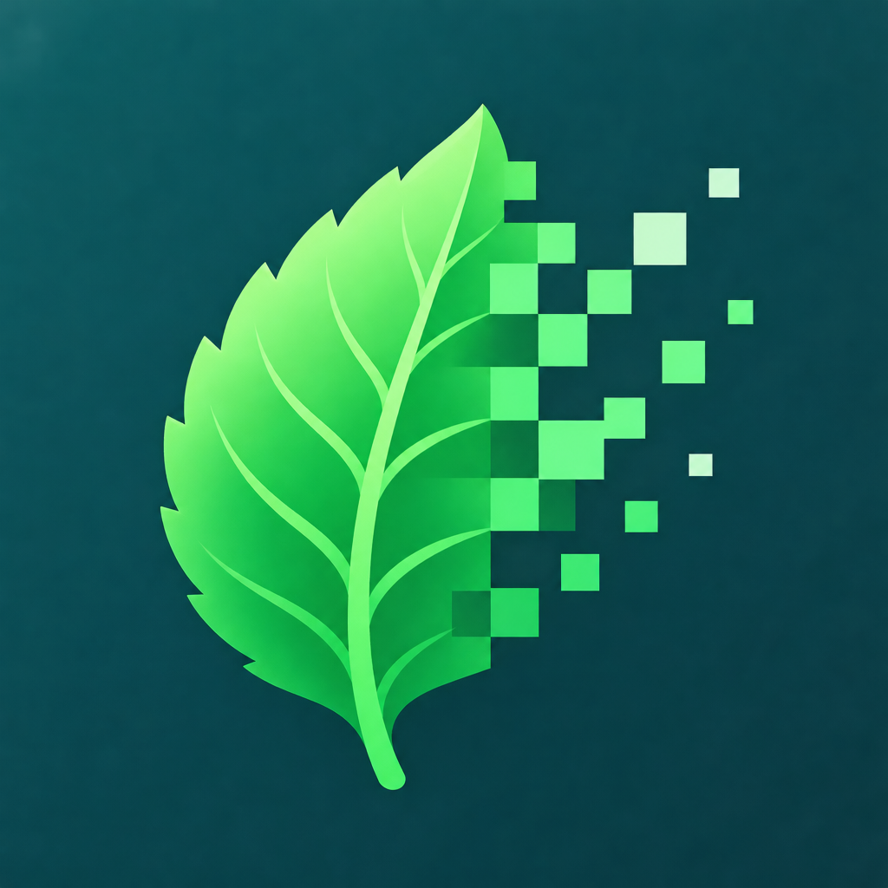

<p align="center">
  
</p>

<h1 align="center">pixmint</h1>

<p align="center">Generate and edit images, SVGs and animated GIFs from Claude Code with the OpenAI Images API.</p>

A [Claude Code](https://code.claude.com) plugin that lets Claude generate and edit images with the [OpenAI Images API](https://developers.openai.com/api/docs/guides/image-generation) using your own OpenAI API key: photos, illustrations, hero images, sprites, textures, mockups, transparent cutouts, SVG logos and illustrations, animated GIFs, and edits of existing pictures (masks, reference images, markup overlays).

Claude writes a structured prompt, starts with a cheap draft, runs the bundled CLI, opens the result to check it against your request, and reports the file path, the prompt and the cost of the call.

> pixmint is not affiliated with or endorsed by OpenAI or Anthropic.

## Install

```text
/plugin marketplace add tsepelev/pixmint
/plugin install pixmint@pixmint
```

Requirements:

- [uv](https://docs.astral.sh/uv/) on your `PATH`. The scripts run in a uv environment pinned by [`uv.lock`](skills/image/scripts/uv.lock) (`openai`, `pillow`), created in `~/.cache/pixmint/venv` (override with `PIXMINT_VENV`). Your project's own virtualenv is never touched.
- An OpenAI API key with access to GPT Image models (your organization may need to complete [verification](https://help.openai.com/en/articles/10910291-api-organization-verification)).

Provide the key in one of two ways:

- set `OPENAI_API_KEY` in your shell profile, or
- save it to `~/.config/openai/api_key` (`chmod 600`); another path can be set with `OPENAI_API_KEY_FILE`.

Then ask Claude to run the check, or run it yourself: `bash <plugin>/skills/image/scripts/run.sh --check`.

## Usage

Just ask in plain language; the skill triggers on requests to draw, generate or edit pictures. Invoke it explicitly with `/pixmint:image`. Examples:

1. *"Make a landing-page hero image of a ceramic mug on a stone table, empty space on the left for copy. Draft first."*
2. *"Generate an orange cat game sprite on a transparent background, 1024×1024."*
3. *"Create an SVG logo for a bakery called Field & Flour."*
4. *"Make a short looping GIF of a blinking cartoon sun."*
5. *"In photo.png, replace only the background with a warm sunset; keep the person unchanged."*

Defaults: model `gpt-image-2.6-flare` (Sunburst for finals and precise edits), quality `medium`, drafts at `low`. Claude asks before using `xhigh`/`max` quality, 4K sizes or many variants.

## What it sends, runs and costs

- **Data sent to OpenAI:** your prompt and any input images, masks or markup overlays you ask to edit go to `api.openai.com` under your API key. For SVG output, OpenAI also runs a text model (default `gpt-6.2-astra`) that writes the SVG. OpenAI's handling of API data is described in its [privacy policy](https://openai.com/policies/privacy-policy/) and [API data usage policies](https://openai.com/policies/api-data-usage-policies/). pixmint itself collects nothing and has no server.
- **Credentials:** the wrapper reads `OPENAI_API_KEY` or the key file and passes it only to the OpenAI Python SDK. The key is never printed or written anywhere.
- **What runs locally:** `bash` and `uv` (which may download Python and the pinned packages from PyPI on first run), the bundled Python scripts, and on macOS optionally `qlmanage` to preview SVGs. Generated files are written only to paths Claude passes with `--out`.
- **Cost:** every call is billed to your OpenAI account. After each call the script prints token usage and an estimated price, e.g. a `low` draft on Flare at 1536×1024 is about $0.02. See [OpenAI pricing](https://developers.openai.com/api/docs/pricing#image-generation).

## Layout

```text
.claude-plugin/plugin.json        plugin manifest
.claude-plugin/marketplace.json   single-plugin marketplace for /plugin install
skills/image/SKILL.md             instructions Claude follows
skills/image/references/          CLI, prompting and recipe references
skills/image/scripts/             image_gen.py, remove_chroma_key.py, run.sh, pinned uv project
```

## Support

Questions and bug reports: [GitHub issues](https://github.com/tsepelev/pixmint/issues).

## License

[Apache License 2.0](LICENSE). Derived from the `imagegen` skill bundled with OpenAI Codex (Apache-2.0); see [NOTICE](NOTICE) for attribution and the list of changes.
